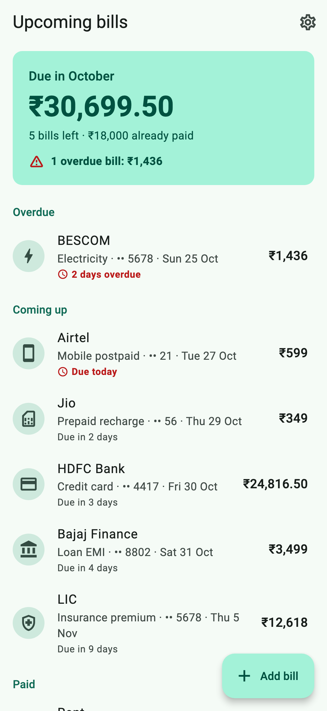
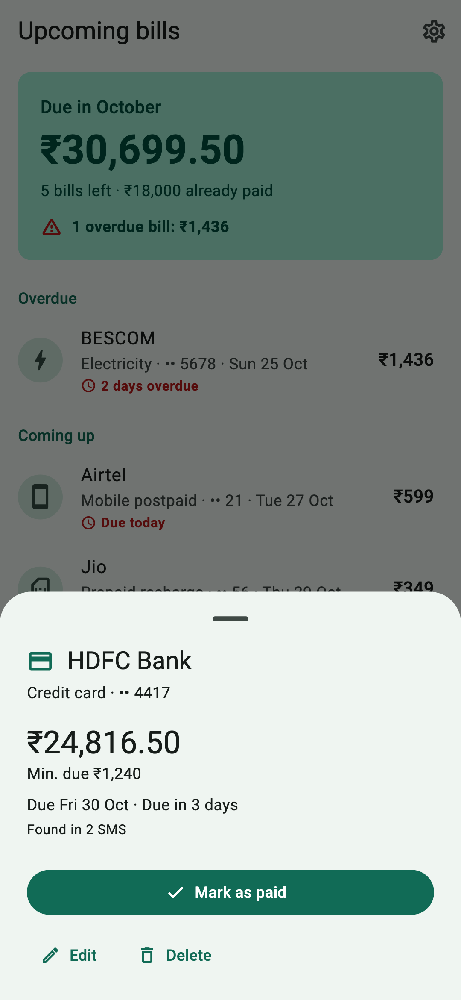
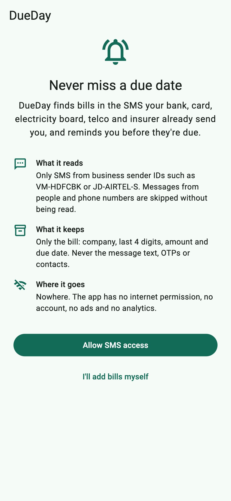
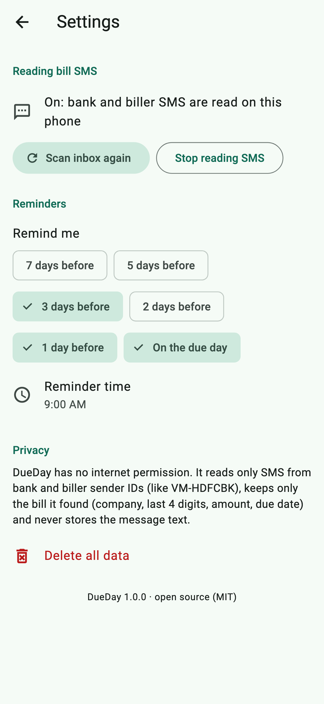

# DueDay: bill reminders from your SMS

[](https://github.com/ChandraChaan/bill-due-reminder/actions/workflows/ci.yml)
[](https://github.com/ChandraChaan/bill-due-reminder/releases/latest)
[](https://github.com/ChandraChaan/bill-due-reminder/releases)


[](LICENSE)

**Your bank, card, electricity board, telco and insurer already text you every bill. DueDay reads those SMS on your phone, lists what's due, and reminds you before each due date.**

No account, no internet permission, no ads, no analytics. The bill it finds (company, last 4 digits, amount, due date) is the only thing it keeps.

<p align="center">
  
  
  
  
</p>

<sub>Screenshots use made-up bills.</sub>

## Download APK

**[Download the latest APK →](https://github.com/ChandraChaan/bill-due-reminder/releases/latest)**

| File | For |
|---|---|
| `DueDay-<version>-arm64-v8a.apk` | Almost every phone from the last 6–7 years (pick this if unsure) |
| `DueDay-<version>-armeabi-v7a.apk` | Older 32-bit phones |
| `DueDay-<version>-universal.apk` | Any phone (bigger download) |

Open the file on your phone and allow installing from your browser or file manager when Android asks. Each release lists SHA-256 checksums in `SHA256SUMS`, and every APK is signed with the same release key, so future versions install as updates.

## How it works

1. On first launch DueDay explains what it reads and keeps, then asks for SMS access. You can say no and add bills by hand instead.
2. It reads the last 120 days of your inbox, but **only messages from business sender IDs** like `VM-HDFCBK` or `JD-AIRTEL-S`. Messages from people, phone numbers and promotional `-P` headers are skipped before their text is read.
3. A parser on the phone pulls out the bill type, company, last digits of the card/account/phone, total and minimum due, and the due date. Statements, "due in 3 days" reminders and "due tomorrow" messages for the same bill are merged into one.
4. New bill SMS are picked up as they arrive, even when the app is closed, and you get a "New bill" notification.
5. You get reminders **3 days before, 1 day before and on the due day** at 9:00 (change the days and time in Settings).
6. When a payment confirmation arrives ("Payment of Rs.24,816.50 received towards your Credit Card XX4417", "EMI debited", "Recharge successful"), the matching bill is **marked as paid automatically** and its reminders stop. You can also mark bills paid yourself, or undo an automatic match.

The home screen shows what's left to pay this month, overdue bills first, then everything coming up.

## Supported bills

| Type | Examples of senders it understands |
|---|---|
| Credit card statements (total due, minimum due, card last 4) | HDFC Bank, ICICI Bank, SBI Card, Axis, Kotak, IDFC FIRST, IndusInd, Yes Bank, RBL, AU, Standard Chartered, Amex, BOBCARD, OneCard, Federal Bank |
| Loan EMIs | HDFC, ICICI, Axis, Bajaj Finance, Tata Capital, HDB Financial, LIC Housing Finance, Muthoot |
| Electricity | BESCOM, MSEDCL, Tata Power-DDL, Tata Power, BSES, Adani Electricity, TNPDCL, TGSPDCL, APSPDCL, KSEB, CESC, UPPCL |
| Water | Delhi Jal Board, BWSSB, HMWSSB, municipal corporations |
| Piped gas | IGL, Mahanagar Gas, Gujarat Gas, Adani Total Gas |
| Postpaid mobile | Airtel, Jio, Vi, BSNL |
| Broadband | Airtel Xstream Fiber, JioFiber, ACT, Hathway, Excitel, BSNL Bharat Fibre |
| Prepaid plan expiry | Jio, Airtel, Vi, BSNL |
| Insurance premiums | LIC, HDFC Life, ICICI Pru, SBI Life, Star Health, Niva Bupa, Tata AIA |

Senders not in the list still work when the message says what it is ("electricity bill", "credit card", "premium") and has an amount and a due date.

It understands `Rs.`, `Rs`, `INR` and `₹`, Indian grouping like `1,23,456.00`, and dates like `05-Nov-26`, `05/11/2026`, `05.11.2026`, `05NOV26`, `5th Nov`, `Nov 5, 2026`, `2026-11-05`, "today", "tomorrow" and "in 3 days". A date without a year gets the year that makes sense ("5th Jan" in December means next January).

OTPs, promotions ("pre-approved", "apply now", cashback offers), spend and debit alerts, money received from people and service messages are not bills and are ignored.

### Automatic "paid"

A payment SMS marks a bill paid only when it's from the same company, for the same kind of bill (a loan EMI debit never settles a card bill), the account digits don't contradict each other, it arrives no later than 30 days after the due date, and the amount is at least the minimum due (or the full amount when there's no minimum). If several bills match, the one due soonest is paid. Bills you typed in yourself are never marked paid automatically.

Something not recognised? [Open an issue](https://github.com/ChandraChaan/bill-due-reminder/issues) with the message **rewritten with fake numbers** (never paste a real SMS with your card or account number).

## How accurate is it?

The parser is tested against **124 synthetic messages** written in the style of real Indian bank, biller and telco SMS: 81 bills of every type above, 14 payment confirmations, and 29 that must be ignored (OTPs, promotions, personal messages, spend alerts, money received from people). All of them pass.

That corpus was also used to tune the parser, so it flatters it. To get a fairer number, 24 of those messages were written *after* tuning, in phrasings the parser hadn't seen: it got **22 of 24 right on the first try** (both misses are now fixed and kept as tests). The 14 payment confirmations were written before the payment matching existed; 13 of 14 parsed on the first run. Expect the occasional miss with an unusual sender, and use **Add bill** for anything it doesn't catch.

## The SMS permission

Android has no way to read only bank messages: an app either gets SMS access or it doesn't. Android's dialog says "send and view SMS messages" because the SMS permissions are shown as one group, but DueDay only asks for `READ_SMS` (the inbox scan) and `RECEIVE_SMS` (new messages). It can't send SMS.

What it does with that access is all in this repository:

- [`SenderFilter.kt`](android/app/src/main/kotlin/dev/chandra/bill_due_reminder/SenderFilter.kt): the check that drops personal messages before their text is read.
- [`SmsBridge.kt`](android/app/src/main/kotlin/dev/chandra/bill_due_reminder/SmsBridge.kt) and [`SmsReceiver.kt`](android/app/src/main/kotlin/dev/chandra/bill_due_reminder/SmsReceiver.kt): the inbox scan and new-message receiver.
- [`packages/sms_bill_parser`](packages/sms_bill_parser): the parser, in plain Dart.

Without the permission DueDay works as a manual bill list with the same reminders. You can turn SMS reading on or off later in Settings.

## Privacy

- **No internet permission** in release builds, so nothing can leave the phone. No account, no sync, no ads, no analytics, no crash reporting.
- Only business-header SMS are read. The **message text is never stored**: only the bill it describes (company, kind, last 4 digits, amounts, due date) and a short hash of each message so it isn't read twice.
- Data lives in the app's private storage and is excluded from Android cloud backup and device-to-device transfer.
- **Delete all data** in Settings removes every bill, setting and scheduled reminder. Your SMS themselves are never changed.

## Why isn't it on Google Play?

Google Play restricts the SMS permissions to default SMS apps and a short list of approved exceptions, each needing a declaration and a review. A small, free, open-source bill reminder isn't a good fit for that process, so DueDay is released here as signed APKs instead, where anyone can read exactly what the app does with the permission.

## For developers

DueDay is a Flutter app with a small Kotlin layer for SMS. Pull requests are welcome.

| Layer | What it does |
| --- | --- |
| [`packages/sms_bill_parser`](packages/sms_bill_parser) | Pure Dart, no Flutter: sender filter, amount/date/account extraction, the bill and payment parser, and `BillBook`, which merges repeated reminders and matches payments to bills. Can be used on its own. |
| `SenderFilter`, `SmsBridge`, `SmsReceiver` (Kotlin) | Permission request, inbox query (business senders only), and the `SMS_RECEIVED` receiver. |
| `BackgroundSync` (Kotlin) + `smsBackgroundMain` (Dart) | When a bill SMS arrives and the app isn't open, starts a headless Flutter engine that reads it, saves the bill, schedules its reminders and shuts down. |
| `lib/features/bills/domain` | `BillService` (scan, ingest, save, reschedule), the reminder planner, repository interfaces. |
| `lib/features/bills/data` | JSON file store, method-channel SMS source, `flutter_local_notifications` scheduler. |
| `lib/features/bills/presentation` | Riverpod controller and screens: first-run explainer, bill list, bill sheet, add/edit form, settings. |

### Build and test

Requirements: Flutter 3.44+, JDK 17, Android SDK.

```bash
flutter pub get
flutter analyze
flutter test                                        # app: planner, ingest, screens
(cd packages/sms_bill_parser && dart test)          # parser + SMS corpus
(cd android && ./gradlew :app:testDebugUnitTest)    # Kotlin sender filter
flutter build apk --release --split-per-abi
```

README screenshots are rendered from the real screens with made-up data: `flutter test test_screenshots --update-goldens`.

To try it on an emulator, send yourself a fake bill SMS from a business sender:

```bash
adb emu sms send VM-HDFCBK "HDFC Bank Credit Card ending 4417: Total Amt Due Rs.24,816.50, Min Amt Due Rs.1,240.00, Due by 13-Nov-26."
```

### Release signing

`android/app/build.gradle.kts` reads `android/key.properties`, which points at a keystore in `android/keystore/`. Both are git-ignored. Without them, release builds fall back to the debug key so the project still builds anywhere.

## License

[MIT](LICENSE)
